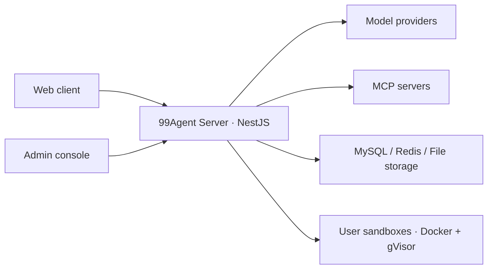

# 99Agent

[](#demo-video)

**An open-source, self-hostable Web Agent foundation.**

[简体中文](./README.md) · English

[▶ Play the overview on this page (1:25)](#demo-video)

[Deployment](./site/deployment/index.md) · [Configuration](./site/configuration/index.md) · [Development](./site/guide/development.md) · [Changelog](./site/changelog.md)

99Agent brings a web client, an admin console, model integrations, multi-user conversations, sandboxed execution, and file delivery into one deployable project. Use it as a starting point for your own agent product, an internal team service, or a workflow extended through Skills and MCP.

Users describe a task and upload their files in the browser. The agent uses tools to process those files, run scripts, and return deliverables in the conversation. Tool activity and results are visible in the interface.

## Demo video

https://github.com/user-attachments/assets/4d549fb0-c25f-4a67-a3a8-1babee8f411a

85 seconds · 1080p / 60fps. This promotional video includes illustrative UI and workflows. Available capabilities depend on your models, Skills, and MCP configuration.

[Download MP4 (9.3 MB)](./assets/readme/99ai-promo.mp4)

> [!IMPORTANT]
> The current version is **0.1.0 beta**, maintained in [vastxie/99AI](https://github.com/vastxie/99AI). This is a rewrite of the previous 99AI product. Its database, configuration, and deployment are incompatible with the old version, so a fresh deployment is required. Back up existing checkouts before cloning again. Old tags and releases are historical references. APIs, configuration, and database structures may change before 1.0.

## Core capabilities

| Capability            | Current implementation                                                                                                                                                                                                             |
| --------------------- | ---------------------------------------------------------------------------------------------------------------------------------------------------------------------------------------------------------------------------------- |
| Web conversations     | Multi-user accounts, conversation history, streaming responses, tool activity, attachments, and deliverables. The web client supports Simplified Chinese, English, and light/dark themes.                                          |
| Isolated execution    | `read`, `write`, `edit`, `bash`, and `ls` run in sandboxes. Production uses Docker + gVisor, with limits on memory, CPU, processes, execution time, output, and storage.                                                           |
| Persistent workspaces | Each signed-in user has one sandbox shared across their conversations. With user disks enabled, files and dependencies installed in the workspace survive idle container cleanup. Guests get a temporary sandbox per conversation. |
| Model integrations    | OpenAI-compatible Chat Completions is built into the core. OpenAI Responses, Anthropic, Gemini, and OpenCode Go are provided through protocol packs.                                                                               |
| Skills and MCP        | Organize task instructions and scripts with `SKILL.md`, connect external tools and business systems through MCP, or add software to the sandbox image.                                                                             |
| Administration        | Manage models, users, site settings, files, and policies. Login providers, object storage, content safety, credits, plans, and payments are supplied by extension packs.                                                           |

## How it works



- **Application host:** The Node.js backend handles authentication, model requests, agent orchestration, conversation persistence, and file assets. It also serves the built web client and admin console.
- **User sandboxes:** File and command tools execute here. A signed-in user's conversations share that user's workspace. Guest workspaces are temporary. Deliverables are saved separately as file assets and follow the site's retention policy.
- **Networking:** Sandboxes use a controlled proxy for public HTTP/HTTPS by default and can be configured with no network access. The backend handles model-provider and MCP connections.

See the [sandbox guide](./sandbox/README.md) for installation, user disks, resource budgets, and network boundaries.

## Quick start

These steps are for a fresh source deployment and are intended to be run by the operator. The main application runs on a Node.js host; Docker is used for user sandboxes.

### 1. Prepare the environment and clone the repository

| Dependency              | Requirement                                                            |
| ----------------------- | ---------------------------------------------------------------------- |
| Node.js                 | 24 LTS recommended; minimum 22.15. Server tests require 24.9 or later. |
| pnpm                    | Version 11, pinned through `packageManager` in each `package.json`.    |
| Database and cache      | MySQL 8.0+ with utf8mb4, and Redis 6.0+.                               |
| Process manager         | PM2 for the production start command below.                            |
| Production sandbox host | Linux, Docker Engine 28+, gVisor `runsc`, and the user disk helper.    |

```bash
git clone https://github.com/vastxie/99AI.git
cd 99AI
```

Follow the [sandbox guide](./sandbox/README.md) to install and configure gVisor, the user disk helper, and the required permissions. The helper and backend must use the same disk root. Choose packs that own database tables before initializing the database; see [pack configuration and removal](./site/deployment/packs.md).

After cloning, run the following commands from the repository root. Commands in parentheses run in a subshell and return to the root automatically.

### 2. Build the frontends and configure the backend

```bash
# Install web/admin dependencies, build, and copy the output to server/public
./dev-build.sh

# Install backend dependencies and create the local configuration
(cd server && pnpm install --frozen-lockfile)
cp server/.env.example server/.env
```

Edit `server/.env` with your MySQL and Redis connections, and check the sandbox runtime, images, and user disk directory. The template defaults to production mode, gVisor, persistent user disks, and controlled network access. Prepare the host accordingly. See the [environment variable reference](./site/deployment/index.md) for the full configuration.

### 3. Build the backend and sandbox images

```bash
(cd server && pnpm build)
docker build -t 99agent/sandbox:latest sandbox/
docker build -t 99agent/sandbox-egress:latest sandbox/egress/
```

The egress proxy image is used by the default `SANDBOX_NETWORK_MODE=egress`. Set the mode explicitly to `none` for sandboxes without network access.

### 4. Initialize a fresh database and start

Make sure `server/.env` points to a new, empty database before running:

```bash
(cd server && node dist/main db:init)
(cd server && node dist/main db:check)
(cd server && pnpm start)
```

Default URLs:

- Web client: `http://localhost:9520`
- Admin console: `http://localhost:9520/admin`

The first startup creates the `super` administrator. Its password comes from `ADMIN_INITIAL_PASSWORD`. If unset, a random password is generated and saved to `server/storage/initial-admin-password.txt`. Change the password after signing in and handle the file appropriately. Keep configuration, passwords, and runtime data out of version control.

Add at least one working model in the admin console. Set its protocol, model ID, base URL, and API key, then test the connection before starting a conversation. See [model management](./site/configuration/ai/model-settings.md).

Normal startup does not alter database tables automatically. See the [deployment guide](./site/deployment/index.md) for initialization, reverse proxies, HTTPS, backups, and upgrades.

### Local development trial

Docker, MySQL, and Redis are still required. For a development environment without gVisor or the user disk helper, explicitly set the following in `server/.env`:

```dotenv
NODE_ENV=development
ISDEV=true
SANDBOX_DOCKER_RUNTIME=
SANDBOX_NETWORK_MODE=none
SANDBOX_USER_STORAGE=tmpfs
```

Use the build and empty-database initialization steps above, then start the built backend in the foreground:

```bash
(cd server && NODE_ENV=development ISDEV=true node dist/main)
```

This mode uses temporary workspaces and does not provide gVisor isolation. Use it only for development trials. The repository's PM2 configuration fixes the environment to production, so this example starts the backend directly with `node dist/main`. See [Contributing](./CONTRIBUTING.md) for development commands and checks.

## Extending the foundation

| Extension        | Purpose and entry point                                                                                                                                                                                                     |
| ---------------- | --------------------------------------------------------------------------------------------------------------------------------------------------------------------------------------------------------------------------- |
| Skills           | Place instructions and scripts in `skills/<name>/` inside the sandbox, with a `SKILL.md` entry point. Inject site-level skills through `SANDBOX_SITE_SKILLS_DIR`.                                                           |
| MCP              | Configure external tool servers in the admin console or through `MCP_SERVERS_JSON` to connect search, data sources, or your own business systems.                                                                           |
| Sandbox software | Extend `sandbox/Dockerfile` with runtime dependencies. The base image includes Python, Node, document, image, audio/video, OCR, and LaTeX tools.                                                                            |
| Extension packs  | Keep the model protocols, login providers, object storage, commerce, content safety, and rich-media rendering packs you need. All are enabled by default; see [pack configuration and removal](./site/deployment/packs.md). |

The core provides multi-user agent conversations, the model gateway, basic tools, and file assets. Decide which table-owning packs to use before database initialization; do not simply remove them from a deployment with existing business data. See [the core and extension packs](./site/guide/index.md) for boundaries and registration points.

## Repository structure

```text
99AI/
├── server/                 # NestJS backend and extension packs
├── web/                    # Vue 3 web client
├── admin/                  # Vue 3 admin console
├── packages/
│   ├── contracts/          # Shared Agent Event Wire contracts
│   └── runtime-core/       # Agent loop core with no production dependencies
├── sandbox/                # Sandboxes, egress proxy, and user disk helper
└── site/                   # Product and deployment documentation
```

## Documentation and contributing

The detailed guides linked below are currently in Chinese.

- **Deploy and use:** [Deployment](./site/deployment/index.md), [configuration](./site/configuration/index.md), [model management](./site/configuration/ai/model-settings.md), and the [changelog](./site/changelog.md).
- **Develop and extend:** [Contributing](./CONTRIBUTING.md), [development guide](./site/guide/development.md), [shared contracts](./packages/contracts/README.md), and the [sandbox guide](./sandbox/README.md).
- **Issues and security:** [Issues](https://github.com/vastxie/99AI/issues), [security policy](./SECURITY.md), and [code of conduct](./CODE_OF_CONDUCT.md). AI coding tools should also follow [AGENTS.md](./AGENTS.md).

CI covers tests and builds for all three applications, shared packages, module boundaries, browser journeys, sandbox images, and Docker + gVisor smoke tests. Smoke tests and browser journeys use a mock model. Commands and coverage are documented in [Contributing](./CONTRIBUTING.md).

Run `./build.sh` when you need a deployment bundle; output goes to `release-build/`. See the [task fixtures](./server/task-fixtures/README.md) for offline checks of sample deliverables.

## License

Licensed under [Apache-2.0](./LICENSE).
