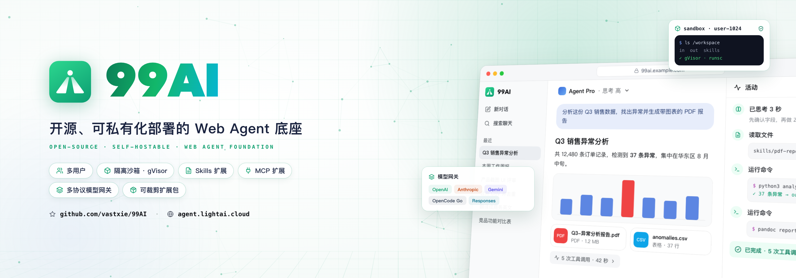

# 99Agent

**开源、可私有化部署的 Web Agent 底座。**

从浏览器里的任务对话，到沙箱执行和文件交付。自带用户端与管理后台，接入你的模型，用 Skills 与 MCP 扩展能力。

简体中文 · [English](./README.en.md)

[安装部署](./site/deployment/index.md) · [后台配置](./site/configuration/index.md) · [二次开发](./site/guide/development.md) · [更新日志](./site/changelog.md) · [交流群](#交流群)

## 演示视频

https://github.com/user-attachments/assets/4d549fb0-c25f-4a67-a3a8-1babee8f411a

85 秒能力演示，包含界面与流程示意。具体能力取决于模型与扩展配置。[下载视频](./assets/readme/99ai-promo.mp4)

## 核心能力

- **任务对话** — 多用户、流式回复、附件上传，工具过程与成果文件直接呈现在对话中。
- **隔离沙箱** — Docker + gVisor 执行命令与处理文件，支持 Python、Node 及文档、图像、音视频工具。
- **持久工作区** — 登录用户拥有独立磁盘，多个对话共用；访客使用临时沙箱。
- **多模型接入** — 支持 OpenAI 兼容接口、Responses、Anthropic、Gemini、OpenCode Go。
- **Skills 与 MCP** — 用技能组织方法和脚本，通过 MCP 连接外部工具与业务系统。
- **按需扩展** — 模型协议、登录、存储、商业等能力按包装配，保留你需要的部分。

## 开始使用

推荐 Node.js 24 LTS、pnpm 11，配合 MySQL 8 与 Redis 6+。生产沙箱需要 Linux、Docker 28+、gVisor 及用户磁盘助手。主应用运行在 Node.js 宿主机上。

```bash
git clone https://github.com/vastxie/99AI.git
cd 99AI
```

1. 按[沙箱指南](./sandbox/README.md)准备运行环境。
2. 按[部署指南](./site/deployment/index.md#install)完成配置、构建与空库初始化。
3. 打开用户端 `http://localhost:9520` 和管理端 `/admin`，在[模型管理](./site/configuration/ai/model-settings.md)中添加模型。

> 当前为 **0.1.0 测试版**，请全新部署，与旧版 99AI 的数据库和配置不兼容。1.0 前接口与数据结构可能调整。

## 开发与贡献

后端使用 NestJS，用户端与管理端使用 Vue 3。你可以通过 Skills、MCP、沙箱镜像和可裁剪的扩展包构建自己的 Agent 产品。

[贡献指南](./CONTRIBUTING.md) · [扩展包指南](./site/deployment/packs.md) · [Issues](https://github.com/vastxie/99AI/issues) · [安全策略](./SECURITY.md)

## 交流群

微信扫码，备注 **99** 进群交流。进群后请先阅读群公告；作者不提供私聊技术咨询。


---

[Apache-2.0](./LICENSE)
