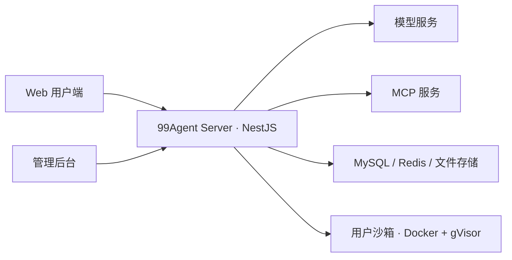

# 99Agent

[](#演示视频)

**开源、可私有化部署的 Web Agent 底座。**

简体中文 · [English](./README.en.md)

[▶ 页面内播放演示（1:25）](#演示视频)

[安装部署](./site/deployment/index.md) · [后台配置](./site/configuration/index.md) · [二次开发](./site/guide/development.md) · [更新日志](./site/changelog.md)

99Agent 把 Web 用户端、管理后台、模型接入、多用户会话、沙箱执行和文件交付放在同一个可部署的项目中。你可以在此基础上搭建自己的 Agent 产品、团队内部服务，或通过 Skills 与 MCP 接入具体业务。

用户在浏览器中提出任务、上传资料，Agent 通过工具调用处理文件、执行脚本，再把成果交付到对话里。工具活动与执行结果在界面中可见。

## 演示视频

https://github.com/user-attachments/assets/4d549fb0-c25f-4a67-a3a8-1babee8f411a

85 秒 · 1080p / 60fps。视频为宣传演示，包含界面与能力示意；可用能力取决于所接模型、Skills 和 MCP 配置。

[下载 MP4（9.3 MB）](./assets/readme/99ai-promo.mp4)

> [!IMPORTANT]
> 当前为 **0.1.0 测试版**，代码与后续维护统一在 [vastxie/99AI](https://github.com/vastxie/99AI)。它是旧版 99AI 的新一代重写，数据库、配置与部署方式均不兼容，请全新部署。旧版克隆请备份后重新克隆；旧 Tag 与 Release 仅供历史查阅。1.0 之前接口、配置项与数据库结构可能调整。

## 核心能力

| 能力          | 当前实现                                                                                                                   |
| ------------- | -------------------------------------------------------------------------------------------------------------------------- |
| Web 对话      | 多用户注册登录、会话记录、流式回复、工具活动、附件与成果文件；用户端支持简体中文 / English、明暗主题。                     |
| 隔离执行      | `read`、`write`、`edit`、`bash`、`ls` 在沙箱中执行；生产使用 Docker + gVisor，并限制内存、CPU、进程、时长、输出与存储。    |
| 持久工作区    | 登录用户每人一台沙箱、多个对话共用；启用用户磁盘时，文件与工作区中安装的依赖在闲置回收后仍保留。访客每个对话使用临时沙箱。 |
| 多模型接入    | 内核自带 OpenAI Chat Completions 兼容协议；OpenAI Responses、Anthropic、Gemini、OpenCode Go 通过协议包接入。               |
| Skills 与 MCP | 用 `SKILL.md` 组织任务方法与脚本，通过 MCP 接入外部工具和业务系统，也可在沙箱镜像中增加软件。                              |
| 管理与运营    | 管理模型、用户、站点、文件与策略；登录渠道、对象存储、内容安全、积分 / 套餐 / 支付等能力按扩展包装配。                     |

## 如何运行



- **应用宿主机**：运行 Node.js 后端，负责鉴权、模型调用、Agent 编排、会话持久化与文件资产；同时提供构建后的用户端和管理端。
- **用户沙箱**：执行文件与命令工具。登录用户的多个对话共用该用户的工作区；访客工作区随临时环境回收。成果另存为文件资产，按站点的保留策略管理。
- **网络**：沙箱默认经受控代理访问公开 HTTP/HTTPS，可配置为无网。模型服务与 MCP 的连接由后端处理。

沙箱安装、用户磁盘、资源预算与网络边界见 [沙箱指南](./sandbox/README.md)。

## 快速开始

以下为从源码全新部署的步骤，命令由部署者执行。生产环境的主应用运行在 Node.js 宿主机上，Docker 用于用户沙箱。

### 1. 准备环境并获取代码

| 依赖         | 要求                                                       |
| ------------ | ---------------------------------------------------------- |
| Node.js      | 推荐 24 LTS，最低 22.15；运行 server 测试需要 24.9 以上。  |
| pnpm         | 11，具体版本由各 `package.json` 的 `packageManager` 固定。 |
| 数据库与缓存 | MySQL 8.0+（utf8mb4）、Redis 6.0+。                        |
| 进程管理     | PM2，用于下面的生产启动命令。                              |
| 生产沙箱宿主 | Linux、Docker Engine 28+、gVisor `runsc` 与用户磁盘助手。  |

```bash
git clone https://github.com/vastxie/99AI.git
cd 99AI
```

先按 [沙箱指南](./sandbox/README.md) 安装并配置 gVisor、用户磁盘助手及运行权限。助手的磁盘根目录须与后端配置一致。启用带数据表的扩展包需要在初始化数据库之前决定，见 [扩展包开关与裁剪](./site/deployment/packs.md)。

克隆后，下列命令均以仓库根目录为工作目录；括号中的命令在子目录执行后自动返回。

### 2. 构建前端并配置后端

```bash
# 安装 web / admin 依赖、构建并同步到 server/public
./dev-build.sh

# 安装后端依赖并创建本地配置
(cd server && pnpm install --frozen-lockfile)
cp server/.env.example server/.env
```

编辑 `server/.env`，填写 MySQL、Redis 连接，并核对沙箱运行时、镜像与用户磁盘目录。模板默认采用生产模式、gVisor、持久用户磁盘与受控联网，需先完成相应的宿主配置。全部配置项见 [环境变量说明](./site/deployment/index.md)。

### 3. 构建后端与沙箱镜像

```bash
(cd server && pnpm build)
docker build -t 99agent/sandbox:latest sandbox/
docker build -t 99agent/sandbox-egress:latest sandbox/egress/
```

出网代理镜像用于默认的 `SANDBOX_NETWORK_MODE=egress`。需要无网沙箱时可显式设为 `none`。

### 4. 初始化全新数据库并启动

确认 `server/.env` 指向全新空库，再执行：

```bash
(cd server && node dist/main db:init)
(cd server && node dist/main db:check)
(cd server && pnpm start)
```

默认访问地址：

- 用户端：`http://localhost:9520`
- 管理端：`http://localhost:9520/admin`

首次启动创建超级管理员 `super`。密码取自 `ADMIN_INITIAL_PASSWORD`；未配置时随机生成，并写入 `server/storage/initial-admin-password.txt`。登录后修改密码，妥善处理该文件，不把配置、密码或运行数据提交到仓库。

在管理端的「AI 能力 / 模型管理」添加至少一个可用模型，填写协议、模型 ID、基础地址与 API Key，完成连接测试后再开始对话。配置方法见 [模型管理](./site/configuration/ai/model-settings.md)。

正常启动不会自动改表。数据库初始化、反向代理、HTTPS、备份与升级说明见 [部署指南](./site/deployment/index.md)。

### 本地开发试用

仍需 Docker、MySQL 与 Redis。没有 gVisor 或用户磁盘助手的开发环境，可在 `server/.env` 中显式设置：

```dotenv
NODE_ENV=development
ISDEV=true
SANDBOX_DOCKER_RUNTIME=
SANDBOX_NETWORK_MODE=none
SANDBOX_USER_STORAGE=tmpfs
```

沿用上面的构建与空库初始化步骤，再前台启动已构建的后端：

```bash
(cd server && NODE_ENV=development ISDEV=true node dist/main)
```

此时工作区是临时的，不具备 gVisor 隔离，只用于开发试用。仓库的 PM2 配置固定使用生产模式，因此此处直接用 `node dist/main` 启动。开发命令与验证方式见 [贡献指南](./CONTRIBUTING.md)。

## 如何扩展

| 扩展方式 | 用途与入口                                                                                                                                      |
| -------- | ----------------------------------------------------------------------------------------------------------------------------------------------- |
| Skills   | 将方法与脚本放在沙箱的 `skills/<name>/`，以 `SKILL.md` 描述使用方式；站点技能可通过 `SANDBOX_SITE_SKILLS_DIR` 注入。                            |
| MCP      | 在管理后台或通过 `MCP_SERVERS_JSON` 配置外部工具服务，对接搜索、数据源或自己的业务系统。                                                        |
| 沙箱软件 | 修改 `sandbox/Dockerfile` 增加运行依赖；基础镜像已包含 Python、Node、文档、图像、音视频、OCR 与 LaTeX 工具。                                    |
| 扩展包   | 按需保留模型协议、登录渠道、对象存储、商业、内容安全和富媒体渲染等包。默认全部启用，开关与裁剪方式见 [扩展包指南](./site/deployment/packs.md)。 |

内核保留多用户 Agent 对话、模型网关、基础工具与文件资产等能力。带数据表的包应在数据库初始化前确定；已有业务数据的站点不要直接删除相关包。边界与注册方式见 [内核与扩展包](./site/guide/index.md)。

## 项目结构

```text
99AI/
├── server/                 # NestJS 后端与扩展包
├── web/                    # Vue 3 用户端
├── admin/                  # Vue 3 管理后台
├── packages/
│   ├── contracts/          # 前后端共享的 Agent Event Wire 合同
│   └── runtime-core/       # 零生产依赖的 Agent 循环内核
├── sandbox/                # 沙箱、出网代理与用户磁盘助手
└── site/                   # 产品与部署文档
```

## 文档与参与贡献

- **部署与使用**：[安装部署](./site/deployment/index.md)、[后台配置](./site/configuration/index.md)、[模型管理](./site/configuration/ai/model-settings.md)、[更新日志](./site/changelog.md)。
- **开发与扩展**：[贡献指南](./CONTRIBUTING.md)、[二次开发](./site/guide/development.md)、[共享合同](./packages/contracts/README.md)、[沙箱指南](./sandbox/README.md)。
- **问题与安全**：[Issues](https://github.com/vastxie/99AI/issues)、[安全策略](./SECURITY.md)、[行为准则](./CODE_OF_CONDUCT.md)；AI 编码工具另遵守 [AGENTS.md](./AGENTS.md)。

CI 覆盖三端测试与构建、共享包、模块边界、浏览器主流程、沙箱镜像和 Docker + gVisor 冒烟。Smoke 与浏览器流程使用模拟模型；验证命令和覆盖范围见 [贡献指南](./CONTRIBUTING.md)。

需要部署包时可运行 `./build.sh`，输出在 `release-build/`。交付样例的离线验证见 [任务样例](./server/task-fixtures/README.md)。

## 许可证

本项目使用 [Apache-2.0](./LICENSE) 许可证。
